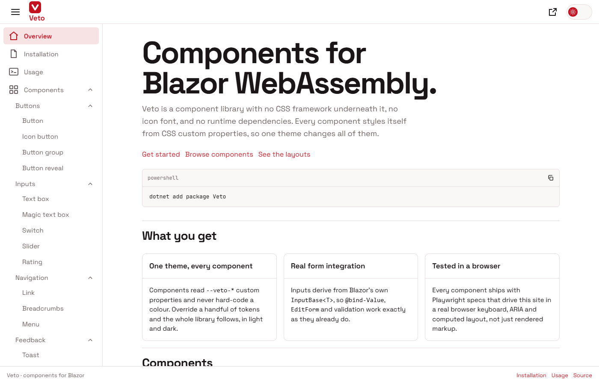
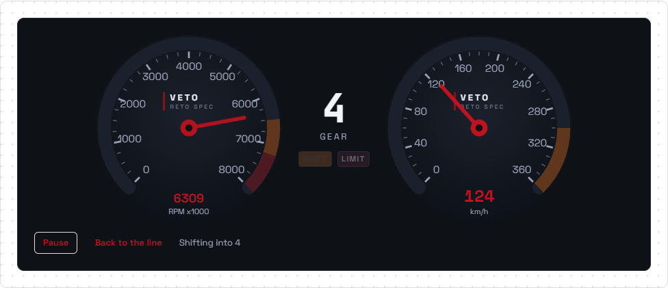
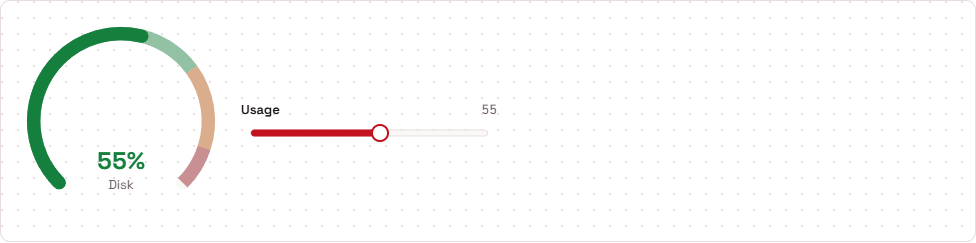
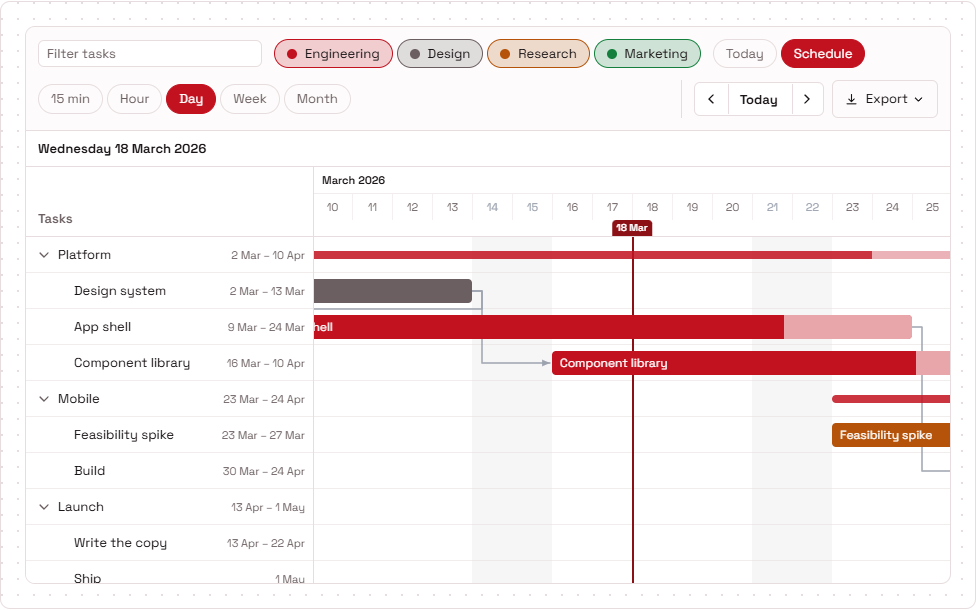
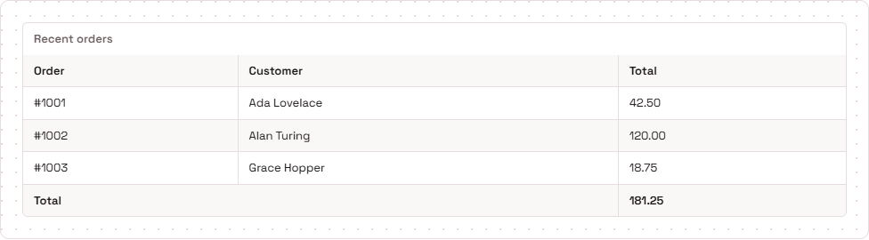
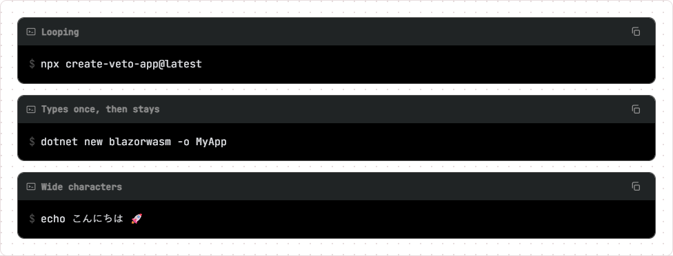

# Veto

Veto is an open source component library for Blazor projects, with no third-party package
dependencies. Developed by G-HK.

Targets .NET 10, and works in any Blazor project - WebAssembly, Server, or a Blazor Web App.

Docs and live demos of every component: **<https://veto.blackpanda.be/>**



## A look at the components

| | |
| --- | --- |
| **Gauge** - a car dashboard built from two `VetoGauge`s ([demo](https://veto.blackpanda.be/docs/components/gauge)) | **Gauge** - bands that colour the reading as it moves |
|  |  |
| **Gantt** - grouped tasks, dependencies, zoom and filters ([demo](https://veto.blackpanda.be/docs/components/gantt)) | **Table** - caption, footer and striped rows ([demo](https://veto.blackpanda.be/docs/components/table)) |
|  |  |
| **Terminal box** - typed-out commands with a copy button ([demo](https://veto.blackpanda.be/docs/components/terminal-box)) | **Buttons** - filled, outlined, text, soft, underlined, ghost and elevated ([demo](https://veto.blackpanda.be/docs/components/button)) |
|  |  |

## Install

Take the whole library:

```powershell
dotnet add package Veto
```

`Veto` is a meta package - it has no components of its own, it just depends on every component
package below. Take individual packages instead if you only want a few; each pulls in
`Veto.Core` and whatever else it genuinely uses, and nothing more:

```powershell
dotnet add package Veto.Buttons
dotnet add package Veto.Layout.Card
```

Then register the services and link the stylesheet:

```csharp
// Program.cs - from the meta package
builder.Services.AddVeto();

// or, with individual packages, the two that register anything:
builder.Services.AddVetoTheming();
builder.Services.AddVetoToast();
```

```html
<!-- App.razor or index.html, inside <head> -->
<script src="_content/Veto.Theming/veto-theme-init.js"></script>
<link rel="stylesheet" href="_content/Veto.Core/VetoStyles.css" />
```

## Packages

Each package has its own README - follow the name for what it does, how to install it
and how to use it.

| Package | Contains |
| --- | --- |
| `Veto` | Meta package: depends on everything below |
| [`Veto.Core`](https://github.com/G-HK/Veto/blob/main/src/Veto.Core/README.md) | Base classes, builders, shared enums, design tokens |
| [`Veto.Theming`](https://github.com/G-HK/Veto/blob/main/src/Veto.Theming/README.md) | Theme provider, theme service, theme toggle |
| [`Veto.BlinkText`](https://github.com/G-HK/Veto/blob/main/src/Components/Veto.BlinkText/README.md) | `VetoBlinkText` |
| [`Veto.Buttons`](https://github.com/G-HK/Veto/blob/main/src/Components/Veto.Buttons/README.md) | `VetoButton`, `VetoIconButton`, `VetoButtonGroup`, `VetoButtonReveal` |
| [`Veto.Code`](https://github.com/G-HK/Veto/blob/main/src/Components/Veto.Code/README.md) | `VetoCode` |
| [`Veto.Cron`](https://github.com/G-HK/Veto/blob/main/src/Components/Veto.Cron/README.md) | `VetoCron` and its parser, describer and scheduler |
| [`Veto.Feedback`](https://github.com/G-HK/Veto/blob/main/src/Components/Veto.Feedback/README.md) | `VetoSpinner`, `VetoProgress`, `VetoSkeleton`, `VetoLoadingOverlay` |
| [`Veto.Gantt`](https://github.com/G-HK/Veto/blob/main/src/Components/Veto.Gantt/README.md) | `VetoGantt` |
| [`Veto.Gauge`](https://github.com/G-HK/Veto/blob/main/src/Components/Veto.Gauge/README.md) | `VetoGauge` |
| [`Veto.Handbook`](https://github.com/G-HK/Veto/blob/main/src/Components/Veto.Handbook/README.md) | `VetoHandbookPage`, `VetoHandbookToc` |
| [`Veto.Icon`](https://github.com/G-HK/Veto/blob/main/src/Components/Veto.Icon/README.md) | `VetoIcon` and the built-in icon set |
| [`Veto.Kbd`](https://github.com/G-HK/Veto/blob/main/src/Components/Veto.Kbd/README.md) | `VetoKbd`, `VetoShortcut`, `VetoShortcutList` |
| [`Veto.MagicTextBox`](https://github.com/G-HK/Veto/blob/main/src/Components/Veto.MagicTextBox/README.md) | `VetoMagicTextBox` - collapses when the text outruns its space |
| [`Veto.Menu`](https://github.com/G-HK/Veto/blob/main/src/Components/Veto.Menu/README.md) | `VetoMenu`, `VetoMenuItem`, `VetoMenuLabel`, `VetoMenuDivider` |
| [`Veto.Navigation`](https://github.com/G-HK/Veto/blob/main/src/Components/Veto.Navigation/README.md) | `VetoLink`, `VetoNavMenu`, `VetoBreadcrumbs` |
| [`Veto.Rating`](https://github.com/G-HK/Veto/blob/main/src/Components/Veto.Rating/README.md) | `VetoRating` |
| [`Veto.Slider`](https://github.com/G-HK/Veto/blob/main/src/Components/Veto.Slider/README.md) | `VetoSlider` |
| [`Veto.Switch`](https://github.com/G-HK/Veto/blob/main/src/Components/Veto.Switch/README.md) | `VetoSwitch` |
| [`Veto.Table`](https://github.com/G-HK/Veto/blob/main/src/Components/Veto.Table/README.md) | `VetoTable` |
| [`Veto.TerminalBox`](https://github.com/G-HK/Veto/blob/main/src/Components/Veto.TerminalBox/README.md) | `VetoTerminalBox`, `VetoTerminalLine` |
| [`Veto.TextBox`](https://github.com/G-HK/Veto/blob/main/src/Components/Veto.TextBox/README.md) | `VetoTextBox` |
| [`Veto.Tilt`](https://github.com/G-HK/Veto/blob/main/src/Components/Veto.Tilt/README.md) | `VetoTilt3D` |
| [`Veto.Toast`](https://github.com/G-HK/Veto/blob/main/src/Components/Veto.Toast/README.md) | `VetoToastHost`, `IVetoToastService` |
| [`Veto.Layout.Card`](https://github.com/G-HK/Veto/blob/main/src/Components/Layout/Veto.Layout.Card/README.md) | `VetoCard` and its composed sections |
| [`Veto.Layout.Container`](https://github.com/G-HK/Veto/blob/main/src/Components/Layout/Veto.Layout.Container/README.md) | `VetoContainer` |
| [`Veto.Layout.Divider`](https://github.com/G-HK/Veto/blob/main/src/Components/Layout/Veto.Layout.Divider/README.md) | `VetoDivider` |
| [`Veto.Layout.Grid`](https://github.com/G-HK/Veto/blob/main/src/Components/Layout/Veto.Layout.Grid/README.md) | `VetoGrid`, `VetoGridItem` |
| [`Veto.Layout.Spacer`](https://github.com/G-HK/Veto/blob/main/src/Components/Layout/Veto.Layout.Spacer/README.md) | `VetoSpacer` |
| [`Veto.Layout.Stack`](https://github.com/G-HK/Veto/blob/main/src/Components/Layout/Veto.Layout.Stack/README.md) | `VetoStack` |
| [`Veto.Layouts.Shell`](https://github.com/G-HK/Veto/blob/main/src/Layouts/Veto.Layouts.Shell/README.md) | `VetoLayout`, `VetoAppBar`, `VetoDrawer`, `VetoMainContent`, `VetoFooter` |
| [`Veto.Layouts.Dashboard`](https://github.com/G-HK/Veto/blob/main/src/Layouts/Veto.Layouts.Dashboard/README.md) | `VetoDashboard`, `VetoDashboardTile` |
| [`Veto.Layouts.DashboardLayout`](https://github.com/G-HK/Veto/blob/main/src/Layouts/Veto.Layouts.DashboardLayout/README.md) | Ready-made dashboard page layout |
| [`Veto.Layouts.Dock`](https://github.com/G-HK/Veto/blob/main/src/Layouts/Veto.Layouts.Dock/README.md) | `VetoDock`, `VetoDockItem` |
| [`Veto.Layouts.DockLayout`](https://github.com/G-HK/Veto/blob/main/src/Layouts/Veto.Layouts.DockLayout/README.md) | Ready-made dock page layout |
| [`Veto.Layouts.DocsLayout`](https://github.com/G-HK/Veto/blob/main/src/Layouts/Veto.Layouts.DocsLayout/README.md) | Ready-made documentation page layout |

Each package has its own version and is released on its own (see [Releasing](#releasing)).

## Repository layout

```
src/
  Veto/                     meta package
  Veto.Core/
  Veto.Theming/
  Components/
    Veto.Buttons/  Veto.Icon/  Veto.Gantt/  ...
    Layout/
      Veto.Layout.Card/  Veto.Layout.Grid/  ...
  Layouts/
    Veto.Layouts.Shell/  Veto.Layouts.DocsLayout/  ...
VetoWeb/                    the docs and demo site, live at https://veto.blackpanda.be/
tests/Veto.Tests.E2E/       Playwright specs
docs/                       concept, contributing, roadmap
```

One project per package - that is the only way NuGet packs, so the folder name and the package
id are deliberately kept identical.

## Releasing

Every package carries its own `<Version>` in its `.csproj` and is released on its own:

1. Bump `<Version>` in the `.csproj` of each package that changed, and commit it to `main`.
2. Move `Production` to that commit: `git push origin main:Production`.
3. In GitHub Actions, run the **release** workflow on `Production` and type the packages to
   release - `Veto.Gantt`, several separated by commas, or `all`. Tick "Run the E2E tests" if
   the release should prove itself first.

Only the packages named are built and packed. The workflow stops before building if a name is
wrong or a version is already on nuget.org, and before publishing if a package depends on a Veto
package version that is neither on nuget.org nor in the same release. It then pushes to
nuget.org via Trusted Publishing and tags each package, e.g. `Veto.Gantt-v1.0.2`.

A package's dependencies on other Veto packages are "this version or newer", so one package can
move ahead of the rest. Release `Veto` as well when everyone installing the whole library
should get the new version by default.
