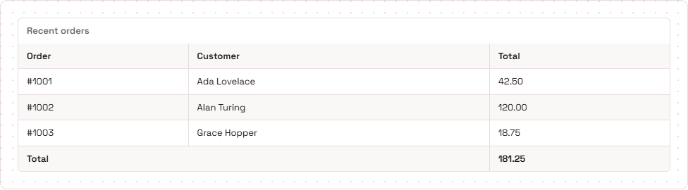

# Veto.Table

A templated table: you supply the header, a row template and an optional footer.

Part of [Veto](https://github.com/G-HK/Veto), a Blazor component library with no third-party dependencies. Install the `Veto` package instead to get every component at once.

Try it live in the docs site: <https://veto.blackpanda.be/docs/components/table>



## Install

```powershell
dotnet add package Veto.Table
```

## Setup

Add the namespaces to `_Imports.razor`:

```razor
@using Veto.Core
@using Veto.Components.Table
```

Link the stylesheet once, inside `<head>` in `App.razor` or `index.html`:

```html
<link rel="stylesheet" href="_content/Veto.Core/VetoStyles.css" />
```

## Usage

```razor
<Table TItem="Person" Items="People" Caption="Team" EmptyText="Nobody here yet."
       OnRowClick="Open" StickyHeader="true" RootMaxHeight="20rem">
    <HeaderTemplate>
        <th>Name</th>
        <th>Role</th>
    </HeaderTemplate>
    <RowTemplate>
        <td>@context.Name</td>
        <td>@context.Role</td>
    </RowTemplate>
</Table>
```

### Paging

`Paging="VetoTablePaging.Pages"` shows `PageSize` rows with Previous and Next; bind `PageIndex`
to follow or set the page. `Paging="VetoTablePaging.Scroll"` is an infinite feed: the next
`PageSize` rows load as the end of the table comes into view, and a Load more button does the
same from the keyboard.

Either works with `Items`, or with `AsyncItems` - an `IAsyncEnumerable<TItem>` read only as far
as the page or scroll position needs:

```razor
<Table TItem="Car" AsyncItems="_cars" Paging="VetoTablePaging.Pages" PageSize="20">
    ...
</Table>

@code {
    // Keep it in a field: the same stream between renders. Assign a new one to start over.
    private IAsyncEnumerable<Car> _cars = Api.StreamCarsAsync();
}
```

With a stream, the pager shows "Page 3" until the stream ends, then "Page 6 of 6". A stream that
throws shows `ErrorText` and stops there. A new page, or a new stream, starts at its first row.

The pager offers first, previous, the page numbers around the current one, next and last, a box
to go straight to a page, and a rows-per-page picker - 5, 10, 25, 50 or 100, or your own list:
`PageSizeOptions="[20, 40, 80]"` (null hides it). Bind `PageSize` to follow the picker.

### Sorting

Write a `TableSortHeader` in place of a plain `<th>` for each column that sorts. Clicking cycles
ascending, descending, then back to the source's order, and the cell carries `aria-sort`:

```razor
<HeaderTemplate>
    <TableSortHeader Title="Car" By="c => c.Name" />
    <TableSortHeader Title="Price" By="c => c.Price" />
    <th>Notes</th>
</HeaderTemplate>
```

With `Items` the table sorts by `By` itself. With `AsyncItems` or `ItemsProvider` the table cannot
reorder rows it does not hold, so bind `Sort` and let the source sort: a provider reads it (the
table asks again when a header is clicked), and a stream is replaced with one in the new order.

### Virtualized rows

For data too large to hold, `ItemsProvider` fetches only the rows in view - Blazor's own
`Virtualize` contract, a start and a count in, those rows and the total out:

```razor
<Table @ref="_table" TItem="Car" ItemsProvider="LoadCarsAsync" RootMaxHeight="20rem" ItemKey="c => c.ID">
    ...
</Table>

@code {
    private async ValueTask<ItemsProviderResult<Car>> LoadCarsAsync ( ItemsProviderRequest request )
    {
        var page = await Api.GetCarsAsync(request.StartIndex, request.Count, request.CancellationToken);
        return new ItemsProviderResult<Car>(page.Items, page.TotalCount);
    }
}
```

`Paging="VetoTablePaging.Virtualize"` does the same over `Items` already in memory. Set `RowHeight`
to the real row height so the scrollbar is right, and call `RefreshAsync()` after the data behind
the provider changes. Virtualized rows are not striped: rows come and go as you scroll, and
alternate shading would flicker.

## Documentation

Every parameter, with a live demo, is documented on the Veto docs site at `/docs/components/table`. Source and issues: https://github.com/G-HK/Veto